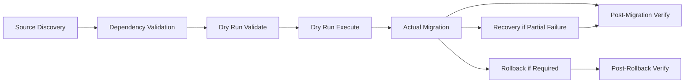

# cnMaestro Migration Automation Portfolio

> Public portfolio summary of an enterprise network migration automation project. This repository intentionally contains **no production source code, credentials, customer data, private API endpoints, or proprietary runtime artifacts**.

## Project Overview

This project demonstrates the design and validation of an enterprise network automation workflow for **cnMaestro On-Premises to Cloud migration** across wireless and switching environments.

The solution was designed around a guarded migration lifecycle:

**Discover → Validate → Dry Run → Execute → Verify → Recover / Roll Back**

The focus was not only on automation speed, but on **production safety, dependency awareness, auditability, partial-failure recovery, and post-change verification**.

## What the Project Covers

- Configuration discovery and dependency analysis
- Configuration migration planning and Dry Run validation
- Access Point migration and post-migration verification
- Switch migration and synchronization validation
- Rollback workflows for configuration, APs, and switches
- Failed-device recovery using child recovery workflows
- Run-ID and session lineage tracking
- One-time production execution controls
- API rate-limit awareness, retry, and backoff handling
- Source-versus-destination configuration validation
- Operator-focused workflow states, diagnostics, and recovery guidance

## Network Domains Applied

- Enterprise Wireless LAN
- AP Groups and WLAN profiles
- VLAN and network dependencies
- ePSK and MAC-authentication related configuration
- Switching and port configuration restore
- Device onboarding and controller/cloud synchronization
- AAA / NAC concepts from Cisco ISE experience
- Controller-based and cloud-managed networking concepts

## Technologies Used

- Python
- REST APIs
- FastAPI
- JSON
- Docker / Docker Compose
- Linux / WSL
- Git / GitHub
- HTTP status/error handling
- API throttling and retry logic
- RBAC and audit/session tracking concepts

## Key Engineering Patterns

### Dry Run Before Production

Production operations are gated by validation stages intended to detect missing dependencies, conflicts, unsupported conditions, and device-readiness problems before live changes are made.

### One-Time Actual Execution

Production migration sessions are consumed after execution so completed changes cannot be accidentally replayed from the same session.

### Partial-Failure Recovery

If a migration partially succeeds, completed devices remain protected while only failed or incomplete devices are selected for a guarded recovery workflow.

### Rollback from Original State

Rollback is based on the original pre-migration context and backup lineage rather than generating a new backup after production state has already changed.

### API Resilience

The workflow accounts for rate limiting, transient HTTP failures, retries, controlled backoff, and synchronization delays while preserving workflow state.

## Example Workflow

## My Contribution

As a network engineer / Staff Engineer, my focus was on translating network-domain requirements into safe automation behavior. Areas included:

- migration sequencing and dependency validation
- AP and switch lifecycle handling
- source-to-cloud configuration fidelity
- production safety and rollback design
- synchronization and onboarding checks
- failed-only recovery behavior
- API error and rate-limit handling
- workflow state and operator guidance
- regression validation across migration and rollback scenarios

## Why This Project Matters

The project demonstrates how deep networking knowledge can be combined with software-driven automation to make large-scale infrastructure changes more repeatable, auditable, and recoverable.

It also reflects practical experience moving from traditional network operations toward **network automation, cloud migration, API-driven orchestration, and reliability-focused engineering**.

## Repository Scope

This public portfolio contains documentation only. The full application source remains private.

No secrets, API tokens, customer information, production URLs, private logs, or proprietary implementation files are published here.

## Contact

For professional discussion, please use my LinkedIn or GitHub profile contact details.
