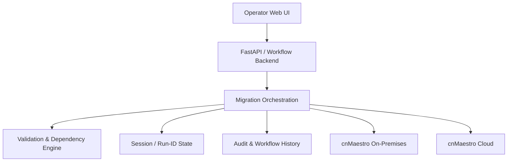

# Architecture Overview

## Logical Components

## Design Principles

1. Validate before changing production state.
2. Track every production operation with explicit session/run lineage.
3. Prevent duplicate Actual execution.
4. Preserve successful work during partial failures.
5. Resume from safe checkpoints where possible.
6. Verify the destination state after migration.
7. Keep rollback tied to original pre-migration state.
8. Treat API rate limits and transient failures as expected operational conditions.
